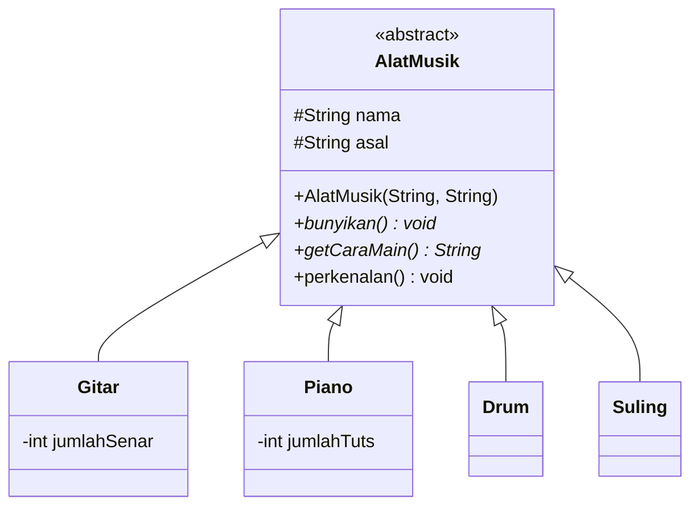

<div align="center">

# 🎵 Sistem Alat Musik 🎵

### Studi Kasus PBO: Abstract Class, Inheritance & Polymorphism


*Satu perintah, banyak suara.* 🎸🎹🥁🪈

</div>

---

## 👥 Anggota Kelompok

| No | Nama | NIM |
|----|------|-----|
| 1 | [Nurlaeli Hidayati] | [F1D02510129] |
| 2 | [Qolbina Aprianti] | [F1D02510132] |

📚 **Mata Kuliah:** Pemrograman Berorientasi Objek (PBO)
🏫 **Program Studi:** Teknik Informatika, Universitas Mataram

---

## 📖 Deskripsi

Program ini memperkenalkan dan memainkan beberapa alat musik: **Gitar, Piano, Drum, dan Suling**. Semua alat musik punya nama, asal, dan bisa dibunyikan, tetapi **cara bunyi dan cara mainnya berbeda**. Karena itu `AlatMusik` dibuat sebagai **abstract class**, dan tiap alat menentukan perilakunya sendiri.

---

## 🗺️ Class Diagram


<details>
<summary>🔍 Lihat versi interaktif (Mermaid)</summary>



</details>

---

## 🧠 Penjelasan Konsep

### 1️⃣ Abstract Class → `AlatMusik`
Class induk yang **tidak bisa dibuat objeknya** dengan `new`.

| Komponen | Keterangan |
|----------|------------|
| 🔒 Abstract method | `bunyikan()` dan `getCaraMain()`: tanpa isi, **wajib** di-override subclass |
| ✅ Method konkret | `perkenalan()`: punya isi, dipakai bersama |
| 🏗️ Konstruktor | Dipanggil subclass lewat `super(...)` untuk mengisi `nama` dan `asal` |

### 2️⃣ Inheritance → `extends`
`Gitar`, `Piano`, `Drum`, dan `Suling` mewarisi `AlatMusik`, sehingga atribut `nama`, `asal`, dan method `perkenalan()` **tidak perlu ditulis ulang** (code reuse).

```java
public class Gitar extends AlatMusik {
    public Gitar(int jumlahSenar) {
        super("Gitar", "Spanyol");
        this.jumlahSenar = jumlahSenar;
    }
}
```

### 3️⃣ Polymorphism → satu perintah, banyak perilaku
Semua objek disimpan dalam `ArrayList<AlatMusik>`. Saat `bunyikan()` dipanggil, Java menjalankan versi milik **objek aslinya** (*dynamic binding*).

```java
ArrayList<AlatMusik> daftar = new ArrayList<>();
daftar.add(new Gitar(6));
daftar.add(new Piano(88));

for (AlatMusik a : daftar) {
    a.bunyikan(); // hasil berbeda tiap objek
}
```

---

## 📂 Struktur Proyek

```
pbo-alat-musik/
├── 📄 README.md
├── 🖼️ class-diagram.png
└── 📁 src/
    ├── AlatMusik.java   ← abstract class
    ├── Gitar.java
    ├── Piano.java
    ├── Drum.java
    ├── Suling.java
    └── Main.java        ← program utama
```

---

## ▶️ Cara Menjalankan

```bash
cd src
javac *.java
java Main
```

---

## 🖥️ Contoh Output

```
===== PERKENALAN ALAT MUSIK =====
Nama      : Gitar
Asal      : Spanyol
Cara main : Senar dipetik atau dipetik dengan pick
Bunyi     : Jreng... jreng... (6 senar)
-------------------------------
Nama      : Piano
Asal      : Italia
Cara main : Tuts ditekan dengan jari
Bunyi     : Ting... tung... (88 tuts)
-------------------------------
```

---

## ✅ Poin yang Diminta Soal

- [x] **Abstract Class** → `AlatMusik`
- [x] **Abstract Method** → `bunyikan()`, `getCaraMain()`
- [x] **Inheritance** → `Gitar`, `Piano`, `Drum`, `Suling`
- [x] **Polymorphism** → `ArrayList<AlatMusik>` dan method `mainkan(AlatMusik)`

---

<div align="center">

Dibuat dengan ☕ dan 💻 oleh **[Nurlaeli Hidayati]** & **[Qolbina Aprianti]**

</div>
