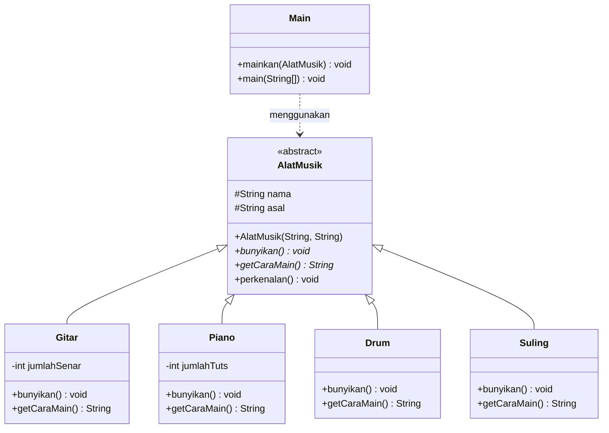
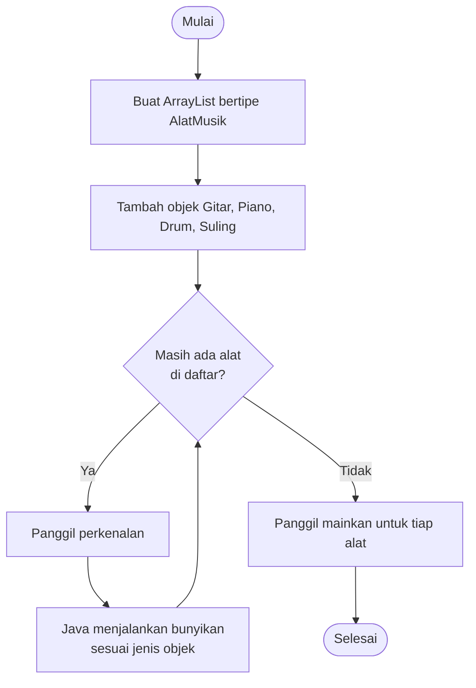

<div align="center">

# 🎵 Sistem Alat Musik 🎵

### Studi Kasus PBO: Abstract Class, Inheritance & Polymorphism


*Satu perintah, banyak suara.* 🎸 🎹 🥁 🪈

</div>

---

## 📑 Daftar Isi

1. [Anggota Kelompok](#-anggota-kelompok)
2. [Deskripsi Program](#-deskripsi-program)
3. [Class Diagram](#️-class-diagram)
4. [Penjelasan Konsep](#-penjelasan-konsep)
5. [Penjelasan Tiap Class](#-penjelasan-tiap-class)
6. [Alur Program](#-alur-program)
7. [Struktur Proyek](#-struktur-proyek)
8. [Cara Menjalankan](#️-cara-menjalankan)
9. [Contoh Output](#️-contoh-output)
10. [Kesimpulan](#-kesimpulan)

---

## 👥 Anggota Kelompok

| No | Nama | NIM |
|:--:|------|-----|
| 1 | Nurlaeli Hidayati | F1D02510129 |
| 2 | Qolbina Aprianti | F1D02510132 |

📚 **Mata Kuliah** : Pemrograman Berorientasi Objek (PBO)
🏫 **Kelas** : 3D
📅 **Tahun** : 2026

---

## 📖 Deskripsi Program

Program ini memperkenalkan dan memainkan empat alat musik: **Gitar, Piano, Drum, dan Suling**.

Semua alat musik punya kesamaan: punya **nama**, punya **asal**, dan bisa **dibunyikan**. Namun **cara bunyi** dan **cara memainkannya berbeda-beda**.

Karena itu `AlatMusik` dibuat sebagai **abstract class**. Class ini menyimpan hal yang sama, sedangkan hal yang berbeda diserahkan ke masing-masing subclass.

> 💡 **Mengapa abstract class?**
> "Alat musik" adalah konsep umum. Tidak ada alat musik yang bunyinya hanya "bunyi alat musik". Bunyinya baru jelas ketika sudah menjadi gitar, piano, drum, atau suling.

---

## 🗺️ Class Diagram



**Cara membaca diagram:**

| Simbol | Arti |
|:--:|------|
| `<<abstract>>` | Class abstract, tidak bisa dibuat objeknya |
| `*` setelah nama method | Method abstract (tanpa isi) |
| `#` | Atribut `protected` (bisa diakses subclass) |
| `-` | Atribut `private` |
| `+` | Method/atribut `public` |
| Panah segitiga kosong `<\|--` | Inheritance (`extends`) |
| Panah putus-putus `..>` | Ketergantungan (class memakai class lain) |

---

## 🧠 Penjelasan Konsep

### 1️⃣ Abstract Class → `AlatMusik`

Class induk yang **tidak bisa dibuat objeknya** dengan `new`.

| Komponen | Keterangan |
|----------|------------|
| 🔒 **Abstract method** | `bunyikan()` dan `getCaraMain()`. Tanpa isi, **wajib** di-override oleh subclass |
| ✅ **Method konkret** | `perkenalan()`. Punya isi dan dipakai bersama oleh semua subclass |
| 🏗️ **Konstruktor** | Dipanggil subclass lewat `super(...)` untuk mengisi `nama` dan `asal` |

```java
public abstract class AlatMusik {
    protected String nama;
    protected String asal;

    public AlatMusik(String nama, String asal) {
        this.nama = nama;
        this.asal = asal;
    }

    public abstract void bunyikan();        // abstract: tanpa isi
    public abstract String getCaraMain();   // abstract: tanpa isi

    public void perkenalan() { ... }        // konkret: ada isi
}
```

### 2️⃣ Inheritance → `extends`

`Gitar`, `Piano`, `Drum`, dan `Suling` **mewarisi** `AlatMusik`. Mereka otomatis punya atribut `nama`, `asal`, dan method `perkenalan()` **tanpa menulis ulang** (*code reuse*).

```java
public class Gitar extends AlatMusik {
    public Gitar(int jumlahSenar) {
        super("Gitar", "Spanyol");   // memanggil konstruktor induk
        this.jumlahSenar = jumlahSenar;
    }
}
```

### 3️⃣ Polymorphism → satu perintah, banyak perilaku

Semua objek disimpan dalam `ArrayList<AlatMusik>`. Saat `bunyikan()` dipanggil, Java menjalankan versi milik **objek aslinya** (*dynamic binding*).

```java
ArrayList<AlatMusik> daftar = new ArrayList<>();
daftar.add(new Gitar(6));
daftar.add(new Piano(88));

for (AlatMusik a : daftar) {
    a.bunyikan();   // hasil berbeda tiap objek
}
```

Polymorphism juga terlihat pada method `mainkan(AlatMusik alat)`. Satu method bisa menerima Gitar, Piano, Drum, atau Suling.

---

## 🔍 Penjelasan Tiap Class

| File | Jenis | Peran |
|------|-------|-------|
| `AlatMusik.java` | 🔒 Abstract class | Induk. Menyimpan `nama`, `asal`, dan kerangka perilaku |
| `Gitar.java` | 🎸 Subclass | Bunyi "Jreng", punya atribut `jumlahSenar` |
| `Piano.java` | 🎹 Subclass | Bunyi "Ting tung", punya atribut `jumlahTuts` |
| `Drum.java` | 🥁 Subclass | Bunyi "Dum tak", dimainkan dengan stik |
| `Suling.java` | 🪈 Subclass | Bunyi "Fuuu fiuu", dimainkan dengan ditiup |
| `Main.java` | ▶️ Program utama | Membuat objek, menampilkan polymorphism |

---

## 🔄 Alur Program



---

## 📂 Struktur Proyek

```
pbo-alat-musik/
├── 📄 README.md
├── 🖼️ class-diagram.png
└── 📁 src/
    ├── AlatMusik.java    ← abstract class
    ├── Gitar.java
    ├── Piano.java
    ├── Drum.java
    ├── Suling.java
    └── Main.java         ← program utama
```

---

## ▶️ Cara Menjalankan

**Syarat:** sudah terpasang **JDK 17** atau lebih baru. Cek dengan `java -version`.

```bash
# 1. Clone repository
git clone https://github.com/USERNAME/PBO-ALAT-MUSIK.git

# 2. Masuk ke folder src
cd PBO-ALAT-MUSIK/src

# 3. Compile semua file
javac *.java

# 4. Jalankan program
java Main
```

---

## 🖥️ Contoh Output

```
==== PERKENALAN ALAT MUSIK ====
Nama      : Gitar
Asal      : Spanyol
Cara main : Senar dipetik atau dipetik dengan pick
Bunyi     : Jreng... jreng... (6 senar)
-------------------------------
Nama      : Piano
Asal      : Italia
Cara main : Tuts ditekan dengan jari
Bunyi     : Tit... tut... (88 tuts)
-------------------------------
Nama      : Drum
Asal      : Amerika Serikat
Cara main : Dipukul dengan stik
Bunyi     : Dum... tak... dum... tak...
-------------------------------
Nama      : Suling
Asal      : Indonesia
Cara main : Ditiup sambil menutup lubang dengan jari
Bunyi     : Fuuu... fiuu... fuuu...
-------------------------------
==== KONSER MINI ====
>> Gitar dimainkan: Jreng... jreng... (6 senar)
>> Piano dimainkan: Tit... tut... (88 tuts)
>> Drum dimainkan: Dum... tak... dum... tak...
>> Suling dimainkan: Fuuu... fiuu... fuuu...
```

---

## ✅ Poin yang Diminta Soal

| Poin | Status | Letak dalam kode |
|------|:--:|------------------|
| Abstract Class | ✅ | `AlatMusik.java` |
| Abstract Method | ✅ | `bunyikan()`, `getCaraMain()` |
| Inheritance | ✅ | `Gitar`, `Piano`, `Drum`, `Suling` memakai `extends` |
| Polymorphism | ✅ | `ArrayList<AlatMusik>` dan `mainkan(AlatMusik)` di `Main.java` |
| Penjelasan kode | ✅ | Komentar di kode dan README ini |

---

## 🎯 Kesimpulan

- **Abstract class** dipakai untuk membuat kerangka umum yang tidak berdiri sendiri.
- **Inheritance** menghindari penulisan kode berulang.
- **Polymorphism** membuat program fleksibel: alat musik baru (misalnya Biola) bisa ditambah tanpa mengubah `Main`, cukup membuat subclass baru.

---

<div align="center">

Dibuat dengan ☕ dan 💻 oleh **[Nurlaeli Hidayati]** & **[Qolbina Aprianti]**

⭐ Universitas Mataram, 2026 ⭐

</div>
